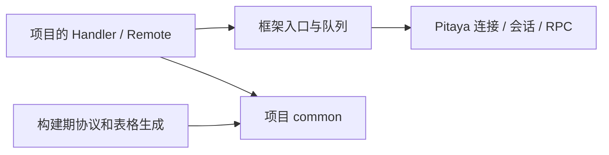

# 模块分工

| 读代码时从哪里开始 | 谁负责什么 |
| --- | --- |
| [App 装配](../../app/pitaya_transport.go) | 框架创建 Pitaya 实例，配置 WebSocket、消息大小、协议收发、NATS 和 etcd。连接进入后，Pitaya 管理 Agent、Session、路由与内部 RPC。 |
| [业务入口](../../app/endpoint.go) | 项目手写 Handler 和 Remote。通过 `app.Call` 或 `app.CallRemote` 接入宿主并发上限、超时、身份检查和错误返回。 |
| [执行队列](../../execution/executor.go)和[保存队列](../../persistence/queue.go) | 前者能让同一 key 的任务在一个进程内顺序执行；后者执行项目提交的写入函数并回报结果。项目决定什么数据需要一起处理。 |
| 配套游戏模板 | gateway 管连接，account 管账号与逻辑区目录，game 管角色和在线玩家，world 演示独立公共玩法。项目维护 `common` 下的协议、配置和数据库模型。 |

模板通过 Go module 引用框架。按配套项目的目录布局部署源码，把框架、模板、协议源和配置表源放在同一个父目录。生成步骤见模板的开发指南；框架自带的独立示例见[集群指南](../implementation/cluster-guide.md)。
