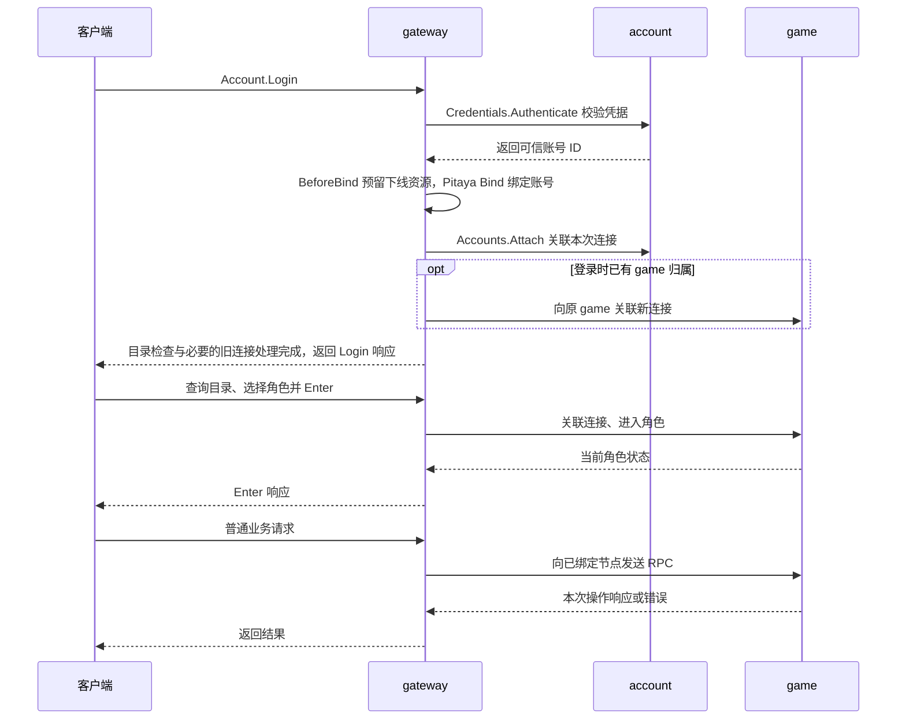

# 登录、重连与服务调用

上图按阶段展示模板的一次登录。`App.Login` 用账号服务校验凭据，验证成功后绑定当前 Session。它返回后，网关才调用项目的 `ConnectionManager.Bind` 让后端接受本次连接。已登录接口通过 `app.Call` 检查当前连接，后端的受保护 Remote 检查业务身份，项目还会核对账号、角色和当前分配。[身份传递](../implementation/service-identity-guide.md)

## 重连与断线

新连接重新认证。替换在线连接时，模板由网关协调，让 account 和已关联的 game 分别确认新绑定，再移交各自的下线通知责任。旧连接正在执行的业务可能已经生效。普通请求在玩家队列执行前再核对绑定，旧连接的迟到通知也要按绑定识别。有效断线才启动相应的退出任务。

客户端进入游戏时获取当前角色状态；断线期间的消息没有续传。主动推送应按用途选择[当前连接推送或按账号广播](../push-and-groups.md)。

## 远端调用失败

`App.RPC` 交给原生路由选择目标；项目已取得归属时，`App.RPCTo` 只调用给定节点。已进入角色的普通请求可使用 `RPCToBoundServer`。目标预检失败并标记 `errorcode.ErrRPCNotSent` 时，请求尚未交给原生 RPC；发出后超时或连接中断，远端可能已经修改状态。框架不会自动改投或重放写请求。[集群指南](../implementation/cluster-guide.md)

`errorcode.Public` 保留项目声明的公开业务错误，隐藏未声明的内部错误详情。项目要在构造业务错误时选好可对外返回的消息和元数据。
