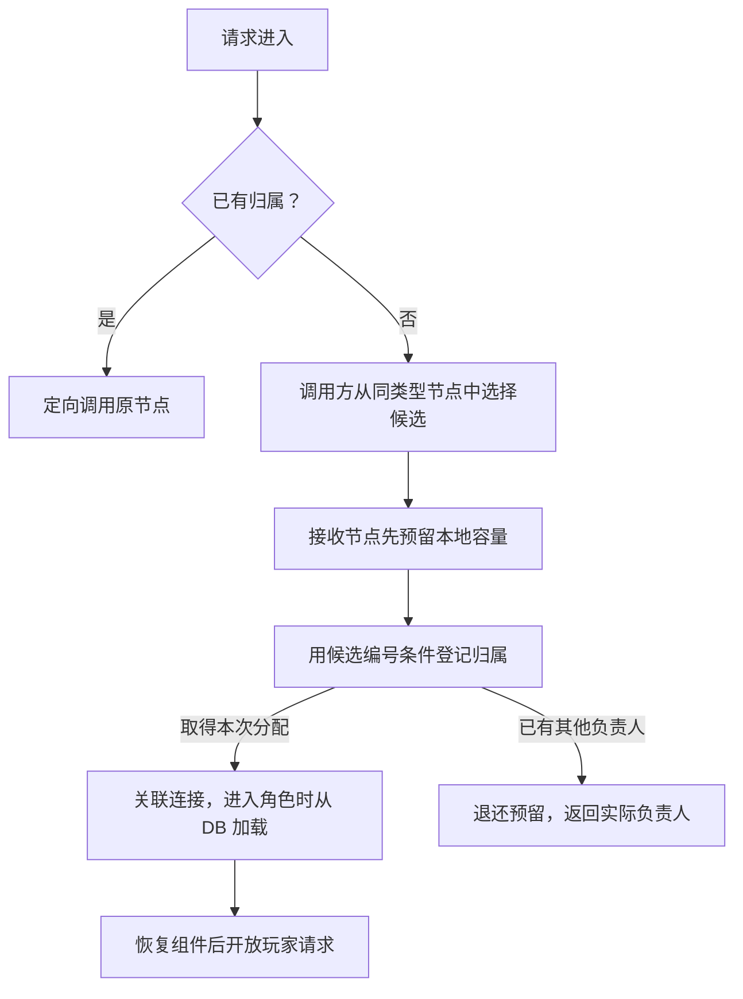

# 状态保存与扩容

模板中的玩家、账号和公共 Boss 都由指定进程持有在线状态。Pitaya 提供当前发现的节点列表，`placement.Registry` 把业务范围、节点 ID 和本次分配编号存在独立的 etcd 键中。MySQL 保存项目业务数据。

## 首次进入和再次进入

新节点参与尚无归属对象的分配。模板对排好序的候选节点按范围标识散列取模。在线玩家保持原节点；正常下线释放后，重登可以选到新增节点。后端失联时正式归属仍然保留，框架不自动迁移内存或接管其写入。

## 保存与释放

- **在线请求。** 在负责该对象的进程中修改内存。玩家循环定期收集已变化组件，生成独立副本并按账号提交给 DB 队列。请求返回时，最近的变化可能仍未写入数据库。
- **入队。** `persistence.Queue.Submit` 的返回错误表示任务没有入队；成功时返回的通道用于接收执行结果。模板在入队成功后清除所提交的变化标记，写入错误会记录日志，不会自动重放整批。
- **玩家退出。** 停止接收该连接的新业务，只提交剩余变化。即使没有新变化，也会等待该账号上一次已提交任务的结果或等到期限。保存失败可以记录后继续退出，因此重登可能看到较旧的数据。
- **Boss 停服。** world 先停止 Boss 执行循环，再逐个收尾。某个 Boss 的最终保存出错、等待其最近一次保存失败或超时时，保留该 Boss 的归属并报告错误；其余 Boss 可继续收尾。一个玩家离线不会关闭公共 Boss。
- **归属释放。** `Registry.Release` 只匹配本次完整分配。这个条件保护 etcd 记录，无法阻止失联旧进程已经发给数据库的写入。写库超时也可能已经生效。

框架的调用入口见[集群与归属](../implementation/cluster-guide.md)，队列实现见[持久化任务](../../persistence/queue.go)。具体数据模型、快照范围、数据库操作和异常恢复由接入项目维护。
