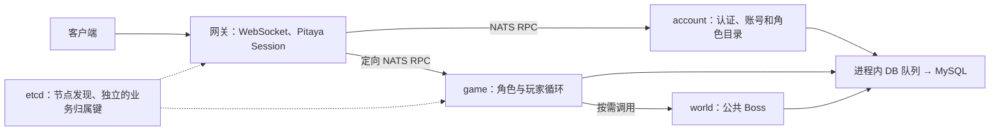

# 架构总览

框架装配 Pitaya 的连接、会话、服务发现和 RPC。游戏项目在这些入口上组织自己的处理顺序、内存状态和数据库操作。

图中服务来自配套游戏模板。etcd 中的两个用途由不同代码维护：Pitaya 用服务发现列出节点；项目通过框架的 `placement` 指明一个账号、玩家或 Boss 当前由哪个实例处理。发现一个新节点不会移动已经在线的玩家。

| 读者要做什么 | 对应指南 |
| --- | --- |
| 决定代码放在哪里 | [模块分工](01-modules.md)、[业务处理范围](02-execution-state.md) |
| 接入登录、重连和远端调用 | [登录与 RPC](03-session-rpc.md) |
| 增加协议，重载配置 | [协议与配置工具](04-contracts-tooling.md) |
| 理解停服、下线与故障边界 | [服务生命周期](05-lifecycle-failures.md)、[状态保存与扩容](10-state-saving.md) |
| 构建并运行服务 | [运行步骤](07-delivery-validation.md)、[观测与诊断](06-operations.md) |
